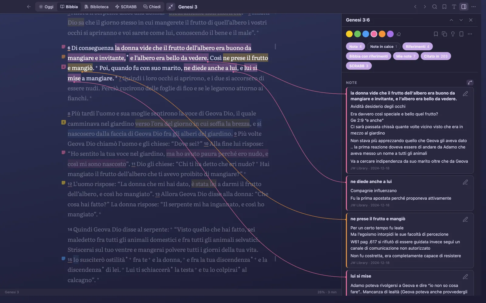
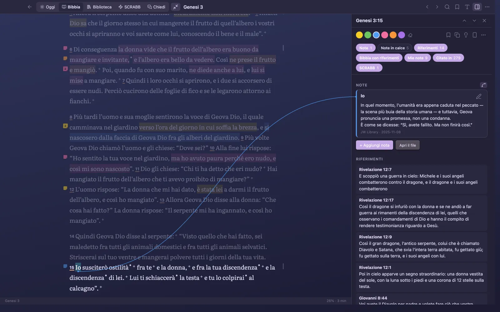
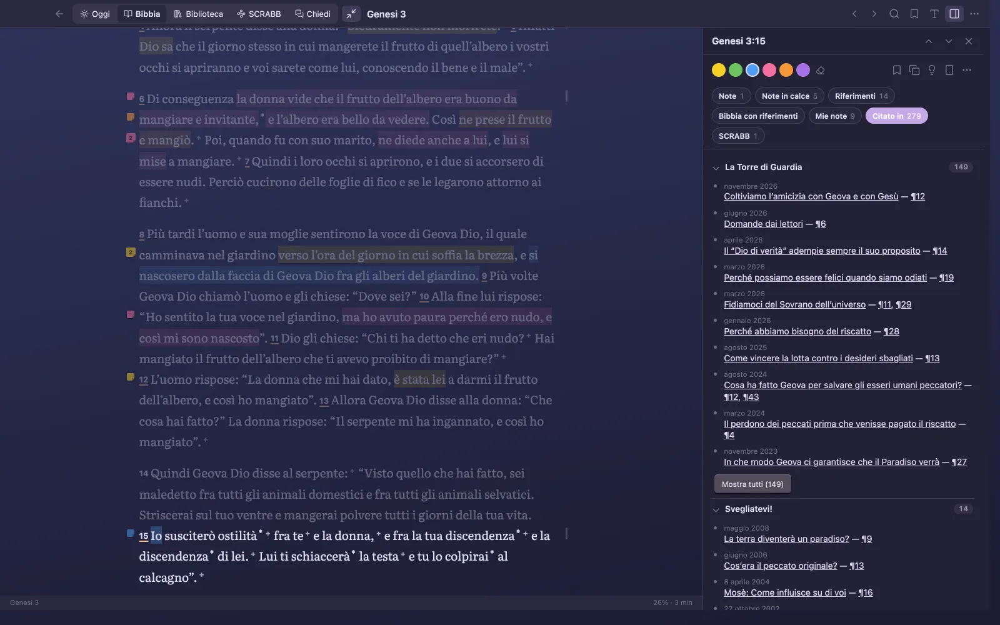
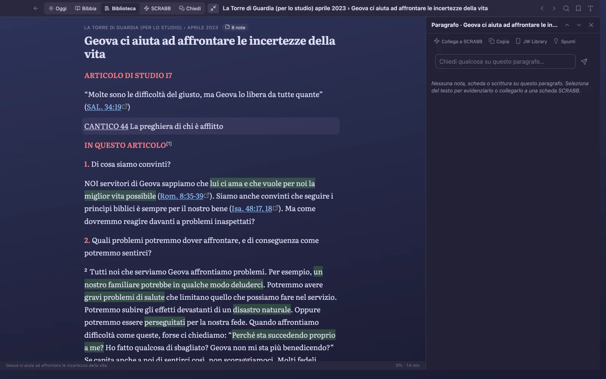
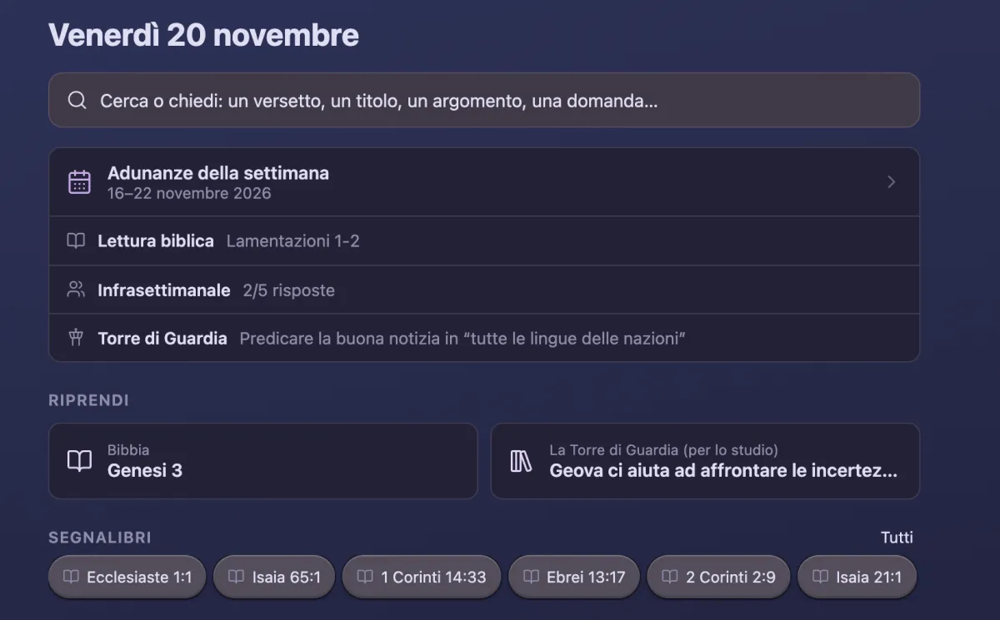
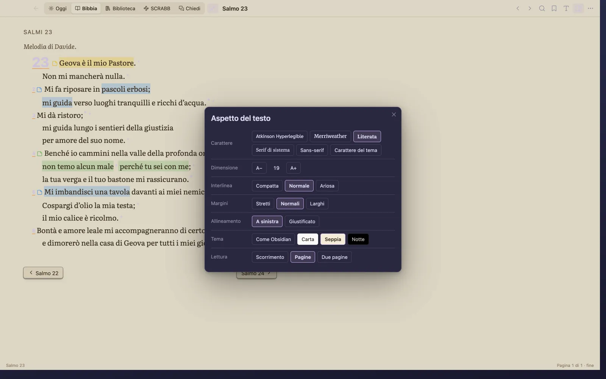
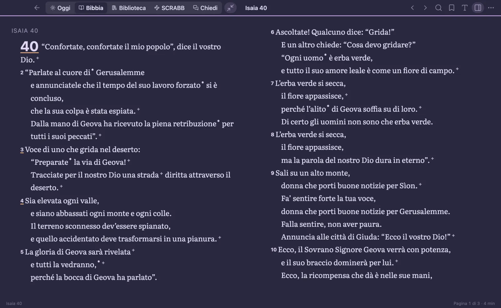
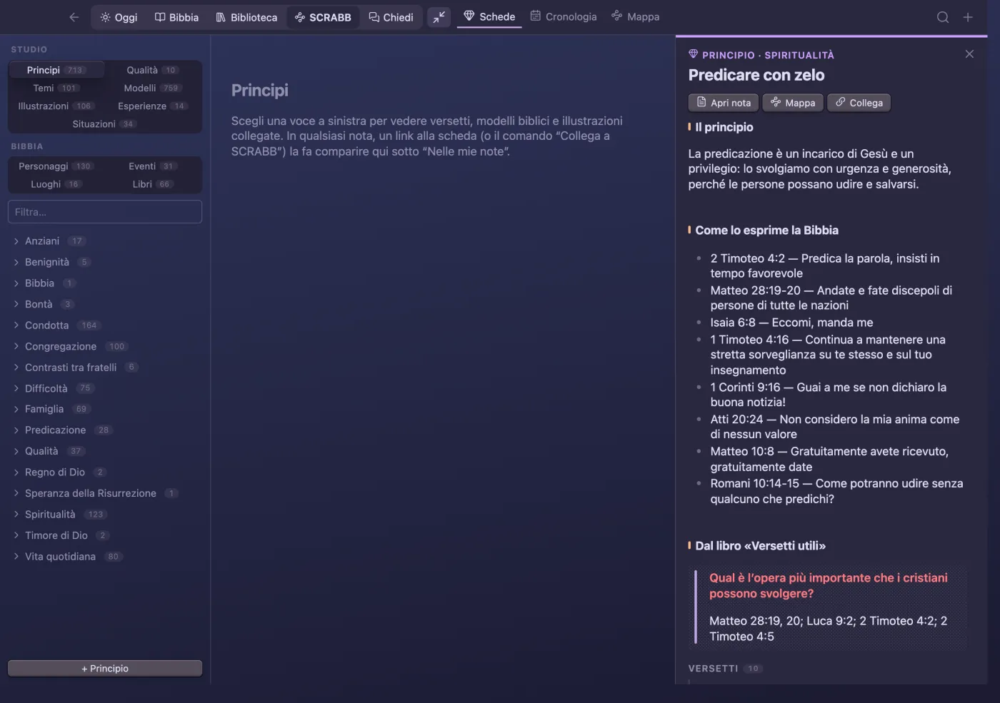

# Lampada

**Tutto lo studio personale in un unico posto: la Bibbia, le pubblicazioni, le tue note e la preparazione alle adunanze, collegate tra loro e sul tuo dispositivo.**

> «La tua parola è una lampada per il mio piede, una luce per il mio cammino» (Salmo 119:105)

Lampada è un plugin per [Obsidian](https://obsidian.md) che riunisce in un solo posto tutto lo studio: leggere, cercare, prendere appunti, preparare le adunanze. Importi gli EPUB delle pubblicazioni, e Lampada li impagina, li indicizza versetto per versetto e paragrafo per paragrafo, e li collega alle tue note. Così ritrovi in un attimo tutto quello che le pubblicazioni dicono su un versetto, e tutto quello che *tu* hai scritto su un argomento.

*Italian only for now. Lampada is an all-in-one, local-first Bible study workspace in Obsidian: reading, full-text and scripture indexing, on-device retrieval (RAG), scripture linking in your notes, highlights tied to notes, study cards and meeting preparation. Your data never leaves your device. Independent, unofficial, free and non-commercial.*



## In breve

| | |
|---|---|
| 📖 **Un lettore fatto per studiare** | Evidenziazioni parola per parola, note legate alle parole con una linea, lettura a pagine o a scorrimento, temi Carta, Seppia e Notte, due pagine sui pieghevoli. |
| 🗂️ **Tutto indicizzato** | Ogni versetto citato, ogni paragrafo, ogni domanda di studio. "Citato in" mostra in un tocco dove le pubblicazioni parlano di un versetto. |
| 🔎 **Ricerca intelligente (RAG)** | *Chiedi* trova i paragrafi pertinenti in tutta la biblioteca e nelle tue note con un indice costruito sul dispositivo. Se vuoi, un assistente AI risponde citando **solo** le tue fonti, con il rimando a ogni paragrafo. |
| 🔗 **Scritture collegate in Obsidian** | "Gv 3:16" scritto in qualsiasi nota diventa un link con anteprima. Ogni versetto sa in quali tue note compare, e `@gv 3:16` lo inserisce mentre scrivi. |
| ✍️ **Note e appunti al centro** | Note sui versetti e sui paragrafi, campi "La tua risposta", schede di studio SCRABB: tutto è un normale file di Obsidian, collegato a quello che leggi. |
| 🔄 **Il tuo backup di JW Library, in Markdown** | Importi un backup `.jwlibrary` e note, evidenziazioni, segnalibri, tag e risposte diventano normali note Markdown. Quando vuoi, esporti un backup con tutto quello che hai fatto in Obsidian e lo riapri in JW Library. |
| 🔒 **Locale, offline, tuo** | Nessun server, nessun account, nessun tracciamento. Lettura, ricerca e note funzionano anche in aereo. |

## Cosa cambia nel tuo studio

**Leggi le scritture mentre prendi appunti.**
Scrivi la tua nota e accanto hai la Bibbia aperta. Scrivi `@gv 3:16` e il versetto entra nella nota, come link o citato per intero. Passi sopra un riferimento e leggi il testo senza cambiare pagina. Con "Apri dopo averlo citato" il lettore va al versetto, e il cursore resta dove stavi scrivendo.

**Ogni versetto si porta dietro tutto quello che sai.**
Apri un versetto e nel pannello di studio trovi le tue note, le note in calce, i paragrafi delle pubblicazioni che lo citano e le note in cui ne hai già scritto, anche anni fa. Nessuna ricerca da fare: è già lì.

**Le tue note non restano isolate.**
Un riferimento biblico scritto in qualsiasi nota del vault, anche a mano come "Salmo 23:1-4", diventa un collegamento. Dal versetto vedi le note, dalle note apri il versetto. Più scrivi, più lo studio si collega da solo.

**Le evidenziazioni parlano.**
Una nota non è "sul versetto 15": è su *quelle* parole, e una linea le unisce. Quando rileggi, capisci subito a cosa pensavi.

**Prepari l'adunanza in un posto solo.**
La settimana è già pronta: lettura biblica, programma, articolo di studio. Scrivi le risposte nei campi "La tua risposta", e se ti serve uno spunto la lampadina ne propone alcuni basati sul paragrafo e sulle scritture citate.

**Ritrovi quello che cerchi, anche senza ricordare dove.**
Una domanda come *"cosa dicono le pubblicazioni sul perdonare chi non si scusa?"* in *Chiedi* restituisce i paragrafi giusti da tutta la biblioteca e dalle tue note, ognuno con il suo rimando.

**Lo studio cresce con te.**
Con le schede SCRABB ogni principio, personaggio, luogo o esempio biblico diventa una scheda che si arricchisce nel tempo, collegata ai versetti e ai paragrafi da cui l'hai imparato.

**Riprendi da dove eri, su ogni dispositivo.**
Inizi sul computer, continui sul telefono in pausa pranzo, finisci sul tablet la sera: posizione, evidenziazioni e note ti seguono attraverso la sincronizzazione del vault.

## Tutto sul tuo dispositivo

Lampada è costruito per funzionare **in locale** dall'inizio alla fine.

- **Offline.** Una volta importate le pubblicazioni, lettura, evidenziazioni, note, "Citato in" e ricerca funzionano senza internet.
- **Nessun server.** Lampada non ha un suo server: non c'è niente da cui dipendere e niente che possa raccogliere i tuoi dati.
- **Nessun account, nessuna statistica, nessun tracciamento.**
- **L'indice è sul dispositivo.** Anche la ricerca di *Chiedi*, con le radici delle parole italiane e il punteggio di pertinenza, è calcolata localmente.
- **I tuoi dati sono file aperti.** Note, evidenziazioni, segnalibri e risposte sono file Markdown e JSON nel tuo vault: li leggi, li copi e li salvi come vuoi, anche senza Lampada.
- **Codice aperto.** Chiunque può verificare cosa fa il plugin, riga per riga.
- **L'unica eccezione è l'assistente AI.** È facoltativo, spento di base, funziona solo con una tua chiave, e invia solo la domanda e i paragrafi necessari (vedi [Servizi esterni](#servizi-esterni)). Senza chiave, Lampada non manda nulla a nessuno.

---

## Perché esiste

Lampada nasce come progetto personale di fratelli Testimoni di Geova: uno spazio dove lo studio della Bibbia e delle pubblicazioni sta insieme agli appunti personali (note, ricerche, schede su personaggi e principi, riflessioni), tutto collegato e ricercabile.

È disponibile come software libero per due motivi:

- **Per chi studia con Obsidian** e vuole avere tutto in un unico posto.
- **Per i fratelli che hanno un dispositivo non più supportato** dagli aggiornamenti di JW Library, o un sistema su cui l'app non esiste (per esempio un computer Linux). Se il dispositivo fa girare Obsidian, con Lampada hanno comunque un posto dove leggere le pubblicazioni scaricate, evidenziare, prendere appunti e prepararsi alle adunanze.
- **Per chi ha un iPhone Duo** e lo apre a libro con grandi aspettative, per poi scoprire che l'app ufficiale non sa ancora cosa farsene di tutto quello spazio. 🙂 Finché non arriva l'aggiornamento, Lampada riconosce la piega e mette due pagine affiancate, come un libro vero.

Lampada **non vuole sostituire** JW Library né jw.org, che restano le fonti ufficiali. È un quaderno di studio che sta accanto a loro. Dove possibile rimanda proprio lì: per esempio "Apri in JW Library" porta il versetto nell'app ufficiale.

## Conformità alle condizioni d'uso

Lampada è progettato per rispettare le [condizioni d'uso di jw.org](https://www.jw.org/it/condizioni-uso/) e i diritti sulle pubblicazioni. Ogni scelta tecnica è stata valutata in buona fede alla luce di queste regole.

| Principio | Applicazione |
|---|---|
| **Nessun contenuto distribuito** | Il repository contiene solo codice. Non include testi, immagini, copertine o file delle pubblicazioni e non li carica su alcun server. Gli screenshot riportano brevi estratti al solo scopo di illustrare il funzionamento. |
| **Solo download consentiti** | Le condizioni d'uso vietano gli strumenti che raccolgono dati, testo, HTML o immagini dal sito, ma ammettono espressamente le *"applicazioni gratuite e non commerciali create per scaricare file elettronici, come i file EPUB, PDF, MP3 e MP4, da aree pubbliche"*. Lampada importa file **EPUB**: scelti dall'utente sul proprio dispositivo, oppure scaricati tramite gli stessi link del pulsante "Scarica" del sito. |
| **Nessuna estrazione dalle pagine web** | Lampada non legge le pagine di jw.org o della Biblioteca online e non ne copia il contenuto. |
| **Nessuna elusione di protezioni** | Lampada non apre file cifrati e non aggira misure tecniche di protezione. |
| **Uso personale e locale** | Le pubblicazioni importate restano nel vault dell'utente e non vengono condivise né trasmesse. Fa eccezione solo l'assistente AI, facoltativo e disattivato per impostazione predefinita (vedi [Servizi esterni](#servizi-esterni)). |
| **Gratuito e non commerciale** | Nessun costo, nessuna pubblicità, nessuna donazione. |
| **Indipendente** | Lampada non è un prodotto ufficiale e non è affiliato ad alcuna organizzazione. JW Library, jw.org e i nomi delle pubblicazioni appartengono ai rispettivi titolari e sono citati solo per indicare la compatibilità. |

Quanto sopra riflette un'interpretazione in buona fede e non costituisce un parere legale. **I titolari dei diritti, o chiunque ritenga necessaria una modifica, possono aprire una [segnalazione](../../issues): ogni richiesta verrà valutata e, se necessario, la funzione interessata sarà corretta o rimossa tempestivamente.**

### Se desideri approfondire

Oltre alle regole, queste scelte si ispirano ad alcuni principi biblici:

- **Rispettare le autorità e le leggi**, comprese quelle sul diritto d'autore: [Romani 13:1-7](https://www.jw.org/finder?wtlocale=I&bible=45013001-45013007), [Matteo 22:21](https://www.jw.org/finder?wtlocale=I&bible=40022021).
- **Essere onesti in ogni cosa**, anche quando nessuno controlla: [Ebrei 13:18](https://www.jw.org/finder?wtlocale=I&bible=58013018), [2 Corinti 8:21](https://www.jw.org/finder?wtlocale=I&bible=47008021).
- **Non prendere ciò che appartiene ad altri**, nemmeno il loro lavoro: [Esodo 20:15](https://www.jw.org/finder?wtlocale=I&bible=02020015), [Efesini 4:28](https://www.jw.org/finder?wtlocale=I&bible=49004028).
- **Trattare gli altri come si vorrebbe essere trattati**: [Matteo 7:12](https://www.jw.org/finder?wtlocale=I&bible=40007012).
- **Essere fedeli nelle piccole cose**: [Luca 16:10](https://www.jw.org/finder?wtlocale=I&bible=42016010).

Articoli di approfondimento:

- [«Perché non è consentito postare pubblicazioni dei Testimoni di Geova su siti Internet o social network?»](https://www.jw.org/finder?wtlocale=I&docid=2018364&srctype=wol&srcid=share), *La Torre di Guardia* (per lo studio), aprile 2018. Spiega cosa dicono le Condizioni d'uso e perché sono importanti. Per questo Lampada non pubblica e non condivide nessun contenuto.
- [«È davvero disonesto?»](https://www.jw.org/finder?wtlocale=I&docid=2010403&srctype=wol&srcid=share), *La Torre di Guardia*, 1° giugno 2010. Parla della proprietà intellettuale e delle licenze dei programmi alla luce di Romani 13.
- [«Domande dai lettori»](https://www.jw.org/finder?wtlocale=I&docid=2001126&srctype=wol&srcid=share), *La Torre di Guardia*, 15 febbraio 2001. Spiega perché le parole "gratuitamente avete ricevuto, gratuitamente date" (Matteo 10:8) non giustificano la copia di pubblicazioni o programmi protetti da copyright.
- [«Non inseguiamo "cose senza valore"»](https://www.jw.org/finder?wtlocale=I&docid=202002325&srctype=wol&srcid=share), *Il ministero del Regno*, settembre 2002. Parla dei siti Internet personali e del contenuto delle pubblicazioni messo in rete.

---

## Cosa puoi fare

### Bibbia

- Libri, capitoli e testo con la poesia impaginata come nell'originale, note in calce e riferimenti, nella misura in cui la Bibbia importata li contiene. La Bibbia scaricata dall'EPUB ha il testo e le note in calce (con i rimandi ai versetti), senza riferimenti a margine, note di studio e "Citato in".
- **Evidenziazioni parola per parola** in sei colori: selezioni il testo e scegli il colore.
- **Note collegate all'evidenziazione.** Ogni nota è legata alle parole a cui si riferisce, e una linea leggera unisce la parola evidenziata alla sua nota nel pannello. Così vedi subito a cosa si riferisce ogni pensiero.
- **Pannello di studio del versetto**: le tue note, note in calce, riferimenti, dove ne hai scritto nelle tue note e dove è citato nelle pubblicazioni. Ogni sezione si accende o si spegne con un tocco.



- **Citato in**: tutti i paragrafi delle pubblicazioni importate che citano il versetto, divisi per pubblicazione e ordinati per data. Tocca un risultato per vedere il paragrafo, poi entra nel documento.
- Un segno a margine indica i **versetti più citati** del capitolo.
- Più finestre della Bibbia aperte insieme, segnalibri e cronologia.



### Biblioteca

- Tutte le pubblicazioni importate, divise per categoria, con evidenziazioni parola per parola anche negli articoli.
- **Campi "La tua risposta"** sotto le domande di studio, da compilare come nell'app.
- Riferimenti biblici cliccabili: il versetto si apre in un'anteprima senza perdere il punto.
- Per ogni paragrafo puoi collegarlo a una scheda SCRABB, copiarlo o aprirlo in JW Library.



### Oggi e la settimana

La pagina iniziale mette insieme quello che serve oggi: la lettura biblica della settimana, l'adunanza infrasettimanale con le risposte già preparate, l'articolo di studio, "Riprendi" per tornare dove eri, i segnalibri e la ricerca.



### Una lettura comoda

- Pannello **Aa**: carattere (Atkinson Hyperlegible, Merriweather, Literata e altri), dimensione, interlinea, margini, allineamento.
- Temi di lettura **Carta**, **Seppia** e **Notte**, indipendenti dal tema di Obsidian.
- Lettura a **scorrimento** o a **pagine**, come su un lettore di libri: piè di pagina con la posizione, tempo di lettura rimasto, "riprendi dal punto".
- Tocco lungo su una parola per la definizione.



### Telefono, tablet e pieghevoli

Lampada è pensato prima di tutto per il telefono.

- **Linguette in basso** (Oggi, Bibbia, Biblioteca, SCRABB, Chiedi) e **modalità app**, che nasconde Obsidian intorno a Lampada.
- Il pannello di studio sale dal basso come un **foglio da trascinare**.
- Le barre si nascondono mentre scorri. Un tocco sul testo passa a schermo intero.
- Campi di testo a 16 px, così iOS non ingrandisce la pagina mentre scrivi.
- Caricamento leggero: le pubblicazioni stanno in una cartella che Obsidian non indicizza, quindi anche un vault con migliaia di documenti resta veloce.
- **Pieghevoli e iPhone Duo**: con lo schermo aperto a libro Lampada riconosce la piega e mette **due pagine affiancate**, con la piega nello spazio tra le pagine. Dove la piega non si rileva, "Due pagine" si attiva a mano dal pannello Aa o da un comando da mettere nella barra del telefono.

<p align="center"></p>



### SCRABB: le tue schede di studio

Uno spazio per costruire, nel tempo, la tua conoscenza della Bibbia: **principi, qualità, temi, modelli biblici, illustrazioni, esperienze, personaggi, eventi, luoghi e libri**. Ogni scheda è una normale nota di Obsidian. Lampada le collega tra loro e ai versetti.

- **Schede**: per ogni principio, i versetti, i modelli biblici e le illustrazioni collegate, e dove ne hai parlato nelle tue note.
- **Cronologia**: eventi e personaggi su corsie, dalla creazione agli ultimi giorni, con zoom.
- **Mappa**: la rete dei collegamenti tra le schede, da esplorare partendo da qualsiasi scheda.
- Dal lettore puoi collegare un versetto o un paragrafo a una scheda con un tocco.




### Le tue note in Obsidian

- I riferimenti biblici scritti nelle tue note ("Gv 3:16", link e wikilink) diventano **cliccabili**, con anteprima. Ogni versetto sa in quali tue note compare ("Nelle mie note").
- Scrivi `@gv 3:16` per inserire il versetto, oppure converti in link i riferimenti scritti a mano.
- **Backup delle note `.jwlibrary`**: importi note, evidenziazioni, segnalibri, tag e risposte da un backup, ed esporti un backup con le modifiche fatte in Obsidian.

### Chiedi: ricerca e risposte con le fonti

- **Ricerca nella biblioteca**: cerca un argomento in tutte le pubblicazioni importate e nelle cartelle di note che scegli. L'indice riconosce le forme delle parole italiane (perdono, perdonare, perdonò…) ed è costruito e interrogato sul dispositivo, offline.
- **Assistente AI (facoltativo), in stile RAG**: prima cerca nell'indice locale i paragrafi pertinenti, poi risponde usando **solo** quelli, con il rimando a ogni fonte da aprire con un tocco. Se le fonti non bastano, lo dice.
- **Spunti per i commenti**: dalla lampadina nel campo "La tua risposta", proposte brevi basate sul paragrafo, sulle scritture citate e sulle tue note. Puoi usare i prompt rapidi o scrivere la tua richiesta.
- L'assistente è **spento di base** e funziona solo con una tua chiave.

---

## Come si installa

Servono una decina di minuti. I passaggi sono gli stessi su computer (Windows, Mac, Linux), telefono e tablet (Android, iPhone, iPad). Dove i nomi dei menu cambiano, Obsidian è in italiano. Se il tuo è in inglese, il nome inglese è tra parentesi.

### 1. Installa Obsidian

1. Scarica Obsidian, gratuito:
   - **computer**: da [obsidian.md/download](https://obsidian.md/download);
   - **Android**: dal Google Play Store;
   - **iPhone e iPad**: dall'App Store.
2. Aprilo e scegli **Crea nuovo vault** (*Create new vault*). Un vault è solo una cartella in cui Obsidian tiene le tue note: dagli un nome, per esempio `Studio`, e scegli dove salvarlo.
   - Sul telefono, se vuoi usare lo stesso vault anche sul computer, leggi prima [Sincronizzare telefono e computer](#sincronizzare-telefono-e-computer): su iPhone, per esempio, il vault va creato direttamente in iCloud.
3. Se hai già un vault con le tue note, puoi usare quello: Lampada non tocca le note che ci sono.

### 2. Attiva i plugin della community

Obsidian, appena installato, blocca i plugin creati da altri.

1. Apri le **Impostazioni** (*Settings*): l'ingranaggio in basso a sinistra sul computer; sul telefono tocca ☰ (o scorri da sinistra), poi l'ingranaggio.
2. Vai in **Plugin della community** (*Community plugins*).
3. Tocca **Attiva i plugin della community** (*Turn on community plugins*). Così disattivi la modalità con restrizioni.

### 3. Installa BRAT

[BRAT](https://github.com/TfTHacker/obsidian42-brat) è un plugin della community che installa i plugin direttamente da GitHub e li tiene aggiornati. Lampada si installa con BRAT.

1. Sempre in **Impostazioni → Plugin della community**, tocca **Sfoglia** (*Browse*).
2. Cerca `BRAT`, apri **BRAT** (di TfTHacker) e tocca **Installa** (*Install*).
3. Al termine tocca **Attiva** (*Enable*).

### 4. Aggiungi Lampada con BRAT

1. Torna nelle **Impostazioni**: nella colonna di sinistra, in fondo, c'è ora **BRAT**. Aprilo.
2. Tocca **Add beta plugin**.
3. Nel campo del repository incolla:
   ```
   https://github.com/rubengrep/lampada
   ```
   (va bene anche solo `rubengrep/lampada`).
4. Lascia la versione su **Latest version** e lascia spuntato **Enable after installing the plugin**.
5. Tocca **Add plugin**. Dopo qualche secondo compare un avviso: Lampada è installato.
6. Controlla in **Impostazioni → Plugin della community**: nell'elenco dei plugin installati **Lampada** deve essere attivo (interruttore acceso). Se non lo è, accendilo.

**Aggiornamenti.** BRAT controlla le nuove versioni di Lampada a ogni avvio di Obsidian, se nelle sue impostazioni è attivo *Auto-update plugins at startup*. Puoi anche aggiornare a mano: nelle impostazioni di BRAT, *Check for updates to all beta plugins and update* (o il comando *BRAT: Check for updates…*).

<details>
<summary><b>Senza BRAT: installazione a mano</b></summary>

1. Apri l'ultima [release](../../releases) e scarica i tre file `main.js`, `manifest.json` e `styles.css`.
2. Nella cartella del vault crea la cartella `.obsidian/plugins/lampada/` e copiaci dentro i tre file. La cartella `.obsidian` è nascosta: sul Mac la mostri con ⌘ Maiusc . nel Finder, su Windows con *Visualizza → Elementi nascosti*.
3. Chiudi e riapri Obsidian, poi attiva **Lampada** in **Impostazioni → Plugin della community**.

Con questo metodo gli aggiornamenti non arrivano da soli: per ogni nuova versione ripeti i passaggi 1 e 2.
</details>

### 5. Primo avvio: scarica la Bibbia

1. Apri Lampada dall'icona della **lampada** nella barra di sinistra. Sul telefono la barra si apre con ☰; in alternativa apri il riquadro dei comandi e cerca *Lampada*.
2. Si apre la pagina **Oggi**. In cima c'è il riquadro per scaricare la Bibbia: scegli la lingua (italiano o inglese) e tocca il pulsante con il peso del file (circa 15 MB).
3. Una finestra mostra il nome e l'indirizzo esatto del file su jw.org e il rimando alle condizioni d'uso: conferma e attendi la barra di avanzamento. Lampada converte l'EPUB nel suo formato e apre Genesi 1.

Se più avanti la Bibbia manca, la riscarichi con il comando *Scarica la Bibbia*.

### 6. Importa le pubblicazioni

1. Apri la **Biblioteca** (dalla linguetta in basso sul telefono, o dal comando *Apri la biblioteca*) e tocca **Importa…** (o usa il comando *Importa un EPUB…*).
2. Hai due modi:
   - **un file EPUB che hai già** sul dispositivo: sceglilo e Lampada lo importa;
   - **il simbolo della pubblicazione**, come nelle citazioni: per esempio `w26.01` (La Torre di Guardia di gennaio 2026), `mwb26.01` (Guida per l'adunanza), `g25.3` (Svegliatevi!), `lff`. Lampada mostra il file da scaricare e chiede conferma, come per la Bibbia.
3. Per i periodici, **Nuovi numeri** nella Biblioteca (o il comando *Cerca nuovi numeri*) cerca i numeri successivi di quelli che hai già, finché il sito risponde che non sono ancora usciti.

Una pubblicazione importata di nuovo si aggiorna, senza doppioni.

### 7. Sistema le impostazioni (facoltativo)

In **Impostazioni → Lampada**:

- **Cartella delle tue note e dei tuoi dati** (di base `Note Bibbia`): qui finiscono le note sui versetti e, nella sottocartella `JW Library/`, evidenziazioni, segnalibri, risposte e posizione di lettura.
- **Vista unica** e **Modalità app**: Lampada si comporta come un'app a sé, con le linguette in basso, e nasconde le barre di Obsidian mentre la usi.
- **Importa backup JW Library**: se vuoi portare in Obsidian le note, le evidenziazioni e i segnalibri di JW Library, prima crea un backup dalle impostazioni di JW Library, poi scegli qui il file `.jwlibrary`.
- **Chiave OpenRouter**: solo se vuoi l'assistente AI di *Chiedi*. Senza chiave tutto il resto funziona lo stesso.

Carattere, dimensione, tema e lettura a pagine si regolano dal pannello **Aa** del lettore, e restano diversi su ogni dispositivo.

Lampada non dipende da altri plugin: BRAT serve solo per installarlo e aggiornarlo.

### Se qualcosa non va

- **Lampada non compare nell'elenco dei plugin**: chiudi del tutto Obsidian e riaprilo, poi controlla di nuovo in *Plugin della community*.
- **BRAT dice che non trova il repository**: controlla di aver incollato l'indirizzo esatto, senza spazi in fondo.
- **Il download della Bibbia o di una pubblicazione non parte**: serve la connessione a internet solo per quel momento; riprova con *Scarica la Bibbia* o *Importa…*.
- **Ho aggiunto o tolto file in `.lampada/` a mano**: usa il comando *Ricarica le pubblicazioni*.
- Per tutto il resto apri una [segnalazione](../../issues).

### Sincronizzare telefono e computer

Lampada salva tutto nel vault, quindi funziona con qualsiasi sistema di sincronizzazione di Obsidian: Obsidian Sync, iCloud Drive o Syncthing. Le impostazioni di lettura (carattere, tema, pagine) restano diverse per ogni dispositivo.

### Dove stanno i dati

| Cosa | Dove |
|---|---|
| Pubblicazioni importate | `.lampada/markdown/`, una cartella nascosta che Obsidian non indicizza |
| Dati ricavati (ricerca, campi risposta, copertine) | `.lampada/data/` |
| I tuoi dati: evidenziazioni, segnalibri, risposte, posizione di lettura | nella cartella delle note che scegli, visibili e tuoi |
| Le tue note e le schede SCRABB | dove preferisci nel vault |

Se aggiungi file in `.lampada/` a mano o con un importatore, usa il comando *Ricarica le pubblicazioni*. Il formato delle pubblicazioni è documentato e aperto: chiunque può scrivere un importatore per i propri file.

## Servizi esterni

Lampada si collega a internet solo in questi casi:

| Servizio | Quando | Cosa invia |
|---|---|---|
| jw.org (`b.jw-cdn.org`, `cfp2.jw-cdn.org`) | solo quando chiedi di scaricare un EPUB o di cercare i nuovi numeri | il simbolo e il numero della pubblicazione, come il pulsante "Scarica" del sito |
| [OpenRouter](https://openrouter.ai) | solo se attivi l'assistente AI con una tua chiave | la domanda e i paragrafi necessari per rispondere |

Prima di ogni download da jw.org una finestra mostra il nome e l'indirizzo esatto di ogni file, il peso e il rimando alle [condizioni d'uso di jw.org](https://www.jw.org/it/condizioni-uso/): il download parte solo con la conferma, con una barra di avanzamento.

Niente statistiche, niente tracciamento, nessun account.

## Privacy

I tuoi appunti, le evidenziazioni e le risposte restano nel tuo vault. Lampada non ha un server e non raccoglie dati. Vedi anche [Tutto sul tuo dispositivo](#tutto-sul-tuo-dispositivo).

## Sviluppo

Il codice è in `src/`, un file per parte: Bibbia, Biblioteca, SCRABB, backup, impostazioni… `main.js` è **generato**: non va modificato a mano.

```
npm run build   # genera main.js con esbuild ed esegue le prove
npm test        # solo le prove (test/*.test.js)
```

esbuild arriva da `npx` alla prima build, quindi nel vault non serve `node_modules`. Chiunque può contribuire: segnalazioni e idee nelle [issue](../../issues), modifiche al codice con una [pull request](../../pulls). Prima di proporre una modifica, `npm run build` deve finire con tutte le prove ✓. I contributi sono accettati con la stessa licenza MIT.

## Crediti

- Caratteri inclusi: [Atkinson Hyperlegible](https://brailleinstitute.org/freefont), [Literata](https://github.com/googlefonts/literata) e [Merriweather](https://github.com/SorkinType/Merriweather), con licenza SIL Open Font License ([testo](LICENSE-fonts.txt)).
- [sql.js](https://github.com/sql-js/sql.js) (licenza MIT), incluso nel plugin per leggere e scrivere i backup.

## Licenza

[MIT](LICENSE). La licenza riguarda solo il codice di Lampada, non le pubblicazioni che importi.
